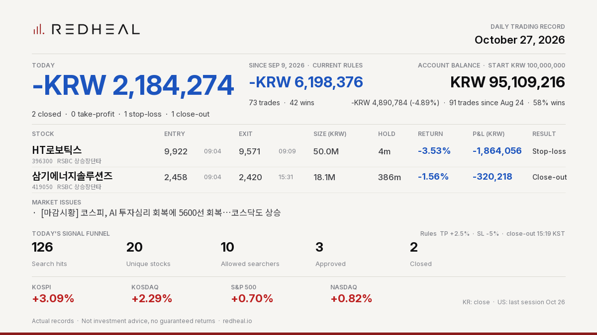

# REDHEAL Auto-Trading — Korea 2026-10-27



```text
REDHEAL Auto-Trading | Oct 27, 2026
Today -KRW 2,184,274 | 2 closed (TP 0/SL 1/EOD 1)
HT로보틱스 -KRW 1,864,056 (-3.53%) SL
삼기에너지솔루션즈 -KRW 320,218 (-1.56%) EOD
Since Sep 9 (current rules) -KRW 6,198,376
Balance KRW 95,109,216 (-4.89% since Aug 24)
Not investment advice.
```

Posted on X: https://x.com/RedhealOfficial/status/2114981710815535465

Actual records. Not investment advice, no guaranteed returns. https://redheal.io
